<div align="center">

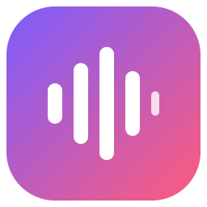

# MeetRec

**Grave suas reuniões, transcreva e receba o resumo pronto, escrito pelo Claude.**

*Teams, Google Meet, Zoom, navegador ou qualquer app: o MeetRec grava sua voz e o som do computador, transcreve com o Whisper e gera notas de reunião no estilo do Notion com o [Claude Code](https://docs.claude.com/en/docs/claude-code/overview).*

<br />

[](https://github.com/luiscriativo/meetrec/releases/latest)
[](LICENSE)
[](https://www.electronjs.org/)
[](https://docs.claude.com/en/docs/claude-code/overview)
[](https://github.com/SYSTRAN/faster-whisper)
[](#-instalação)

<br />

[**⬇ Baixar**](https://github.com/luiscriativo/meetrec/releases/latest) · [Todas as versões](https://github.com/luiscriativo/meetrec/releases) · [Extensão do navegador](#-extensão-do-navegador-teams--meet)

<br />

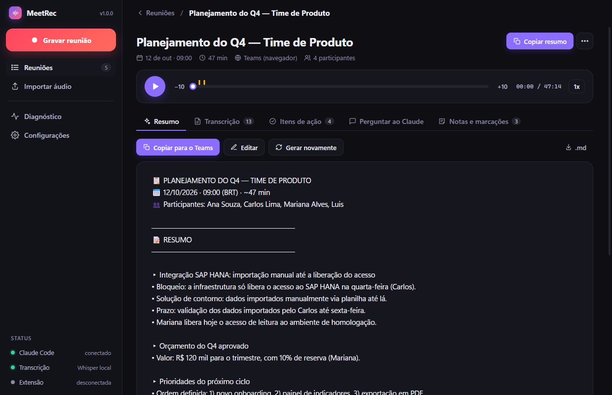

</div>

---

## O que é o MeetRec?

O MeetRec é um **app de desktop que fica na bandeja do sistema** e grava reuniões de qualquer lugar: uma chamada do Teams no navegador, o Zoom, o Google Meet, uma ligação no WhatsApp. Ele capta **duas fontes ao mesmo tempo**:

- 🎙 **sua voz**, pelo microfone;
- 🔊 **o som do computador**, que são as outras pessoas da reunião.

Quando você para, ele **transcreve** cada faixa com o Whisper, **separa quem falou** e chama o **Claude Code** do seu computador para escrever o resumo, com temas, decisões, prazos e itens de ação com responsável, no formato pronto para colar no Teams.

Tudo fica numa pasta local no seu computador. Não há conta, assinatura nem servidor do MeetRec.

<div align="center">
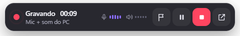
<br /><sub>O indicador flutuante, estilo Notion: tempo, níveis de áudio e controles, sempre à vista.</sub>
</div>

---

## ✨ Recursos

**⏺ Gravação que não atrapalha**
- Fica na **bandeja do sistema**. O ícone muda de cor quando grava, pausa ou processa.
- **Indicador flutuante** sempre visível, com tempo, níveis do microfone e do PC, marcar, pausar e parar. Pode ser arrastado para qualquer canto e **não aparece quando você compartilha a tela**.
- **Atalhos globais**: `Ctrl+Shift+R` grava/para e `Ctrl+Shift+M` marca um momento importante.
- **Detecção de reunião**: quando o Teams, o Zoom ou o navegador começa a usar o microfone, o MeetRec pergunta se você quer gravar. Quando a reunião acaba, sugere parar.
- **À prova de falhas**: o áudio é salvo em disco a cada segundo. Se o app ou o PC cair, a gravação é recuperada.
- **Avisos em tempo real**: microfone mudo há 45 s, nenhum som do PC há 2 min, microfone desconectado (o app troca sozinho para o padrão).

**📝 Anotações e marcações durante a reunião**
Escreva notas e marque momentos enquanto grava. O Claude leva os dois em conta no resumo, e as marcações aparecem na linha do tempo do player.

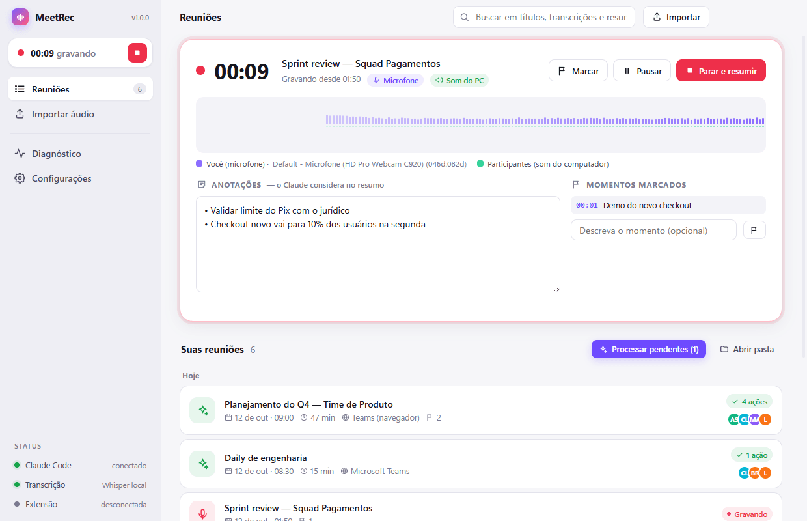

**🗣 Transcrição com quem disse o quê**
- Sua voz e a dos participantes são gravadas em **faixas separadas**, então o MeetRec sabe o que **você** falou e o que **os outros** falaram. O eco das caixas de som é removido automaticamente.
- Com a [extensão do navegador](#-extensão-do-navegador-teams--meet), cada fala recebe **o nome da pessoa** no Teams ou no Meet.
- Clique no horário para ouvir o trecho, busque na transcrição, acompanhe o áudio e **renomeie falantes** ("Participante" → "Ana") em toda a transcrição de uma vez.

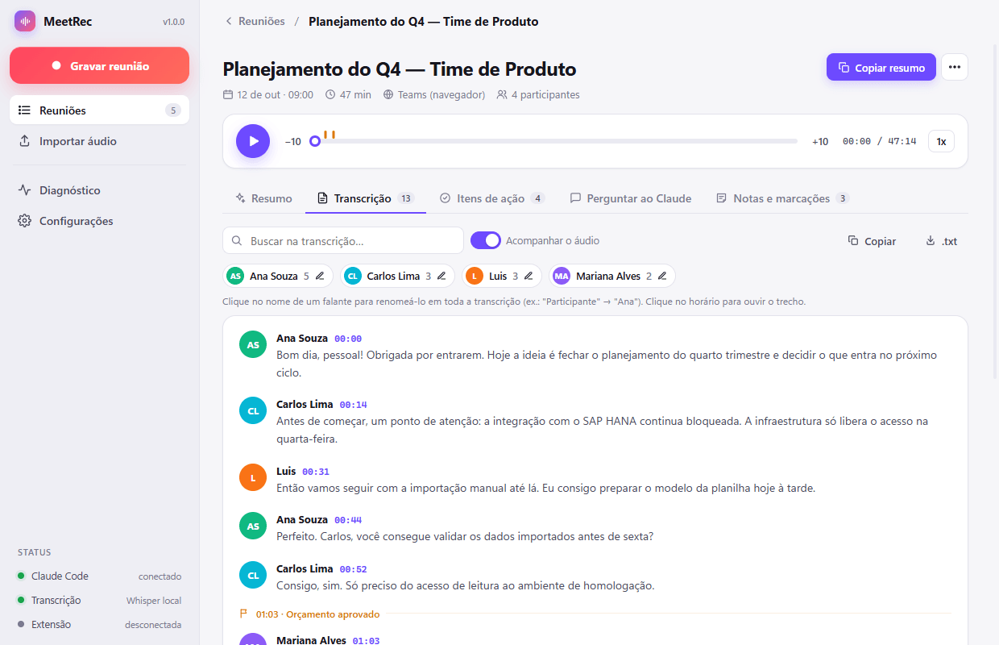

**✨ Resumo pelo Claude Code, ao vivo**
- O resumo aparece **sendo escrito em tempo real**.
- Segue o formato da sua skill [`resumo-reuniao`](#formato-do-resumo) (se você tiver uma) ou o formato estilo Notion embutido.
- **Copiar para o Teams** com um clique, sem Markdown quebrado. Também dá para editar, gerar de novo ou exportar em `.md`.
- Os **itens de ação** viram uma checklist com responsável.

**💬 Pergunte ao Claude sobre a reunião**
"O que ficou pendente para mim?", "Escreva um e-mail de follow-up", "Quais riscos foram levantados?". O Claude responde com base na transcrição e cita os horários.

<table>
<tr>
<td>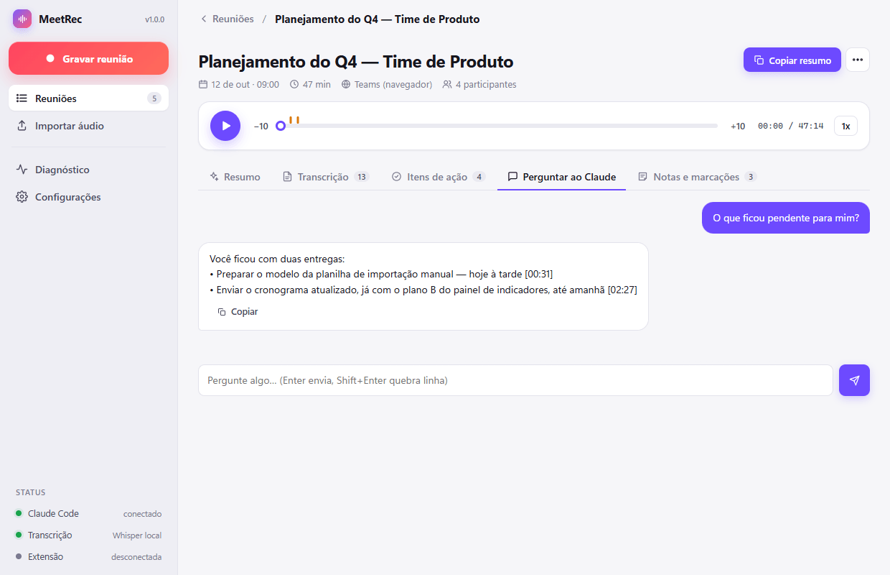</td>
<td>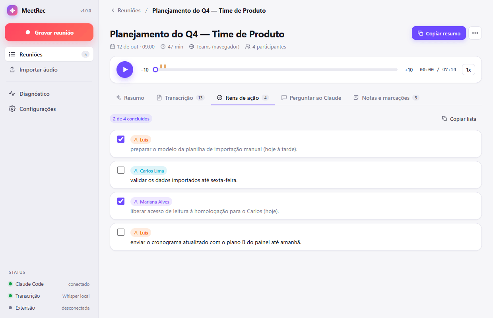</td>
</tr>
</table>

**🧰 E mais**
- **Biblioteca** de reuniões agrupada por dia, com busca em títulos, transcrições e resumos.
- **Importe** áudios e vídeos existentes (mp3, m4a, wav, mp4, mkv…) para transcrever e resumir.
- **Exporte** o resumo (`.md`), a transcrição (`.txt`) e o áudio (MP3).
- Modo **"só gravar"**: grave o dia todo e use **Processar pendentes** quando o PC estiver livre.
- O processamento **nunca compete com uma gravação**: a fila espera, e o Whisper roda com prioridade baixa.
- **Diagnóstico** que verifica tudo e instala o que falta com um clique.
- **Atualização automática**: quando sai uma versão nova, o app avisa. No Windows ele baixa e instala sozinho (veja [Atualizações](#-atualizações)).
- Tema claro e escuro, notificações do sistema e sons discretos.

---

## ⚙️ Como funciona

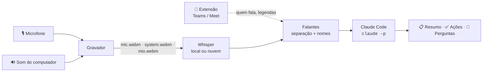

1. **Gravação**: o microfone e o som do sistema (loopback) são gravados em faixas separadas e numa faixa mixada para ouvir.
2. **Transcrição**: cada faixa passa pelo Whisper, rodando no seu PC ou na nuvem (veja [motores](#-motores-de-transcrição)).
3. **Falantes**: o que veio do microfone é você, e o que veio do sistema são os participantes. O eco é descartado, e os eventos da extensão dão nome a cada fala.
4. **Resumo**: o MeetRec chama o Claude Code instalado no seu computador (`claude -p`), já logado na sua conta, e mostra o texto conforme ele é escrito.

> **Por que não transcrever direto com o Claude?** O Claude lê texto e imagens, mas não áudio. O Whisper transcreve o áudio e o Claude entende o texto.

---

## 📦 Instalação

Baixe o instalador do seu sistema na **[última versão](https://github.com/luiscriativo/meetrec/releases/latest)**:

| Sistema | Arquivo |
|---|---|
| **Windows** (x64 e ARM) | `MeetRec-<versão>-win-x64-setup.exe` · ou a versão `portable` |
| **macOS** Apple Silicon (M1 ou mais novo) | `MeetRec-<versão>-mac-arm64.dmg` |
| **macOS** Intel | `MeetRec-<versão>-mac-x64.dmg` |
| **Linux** x64 / ARM | `.AppImage` · `.deb` · `.rpm` |
| **Extensão** Chrome / Edge / Brave | `MeetRec-<versão>-browser-extension.zip` |

### Requisitos

| Para | Você precisa de |
|---|---|
| Resumos e perguntas | [Claude Code](https://docs.claude.com/en/docs/claude-code/setup) instalado e logado (`npm i -g @anthropic-ai/claude-code`, depois rode `claude` uma vez) |
| Transcrição local | Python 3.9+. O pacote `faster-whisper` é instalado pela tela **Diagnóstico** |
| Transcrição na nuvem | Uma chave do [Groq](https://console.groq.com/keys) (rápido, plano gratuito) ou da [OpenAI](https://platform.openai.com/api-keys) |

O FFmpeg já vem embutido no app.

### Primeira execução por sistema

- **Windows**: o SmartScreen pode pedir confirmação (**Mais informações → Executar assim mesmo**). O som do computador é capturado nativamente.
- **macOS 13+**: o app não é notarizado. Na primeira vez, clique com o botão direito → **Abrir**. Depois, permita **Microfone** e **Gravação de Tela e Áudio do Sistema** em *Ajustes do Sistema → Privacidade e Segurança*. É assim que o macOS libera o áudio do sistema.
- **Linux**: em *Configurações → Áudio e gravação*, escolha o dispositivo **"Monitor of …"** da sua saída de som como fonte do áudio do sistema (PulseAudio/PipeWire).

Ao abrir, o MeetRec mostra uma tela de boas-vindas com a verificação de tudo. A tela **Diagnóstico** aponta e corrige o que faltar.

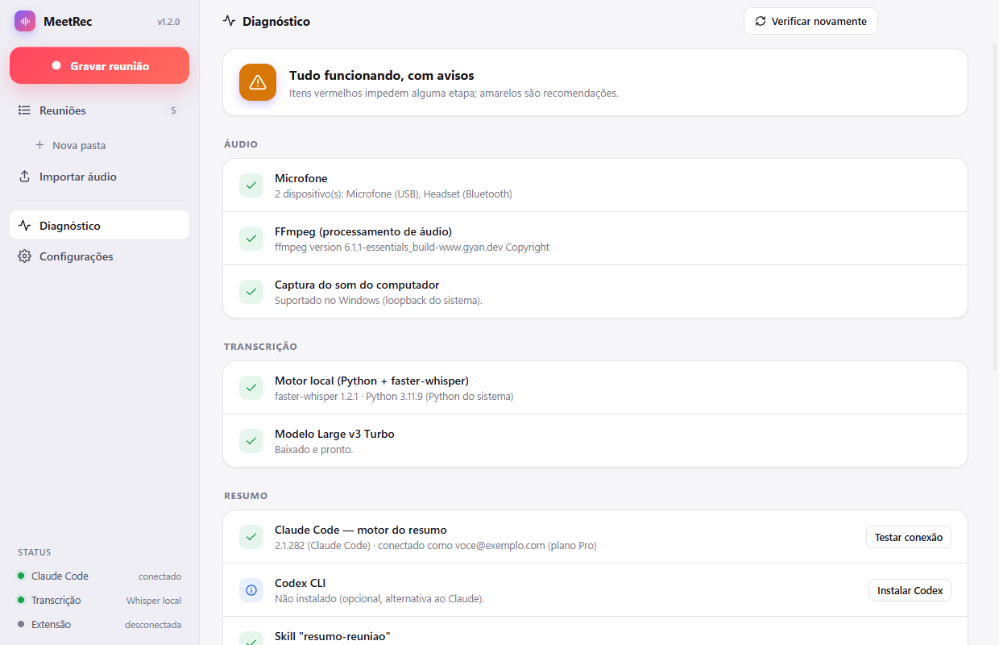

---

## 🔄 Atualizações

O MeetRec procura versões novas nas [releases do GitHub](https://github.com/luiscriativo/meetrec/releases) ao abrir e a cada 6 horas. Quando encontra, mostra um aviso no topo do app e na bandeja.

| Instalação | Como atualiza |
|---|---|
| **Windows** (instalador) | **Baixar atualização** baixa no próprio app, com progresso e velocidade. Depois é só **Reiniciar e instalar**, ou ela é instalada quando você fechar o app. Só a diferença é baixada (blockmap). |
| **Linux** AppImage | Igual ao Windows: baixa e instala pelo app. |
| **macOS** | O aviso abre a página da nova versão para baixar o `.dmg`. Sem certificado da Apple, o macOS não deixa o app se substituir sozinho. |
| **Windows portátil**, Linux `.deb` / `.rpm` | O aviso abre a página da nova versão. |

O app **nunca reinicia durante uma gravação**: o botão de instalar pede para parar antes, e avisa se houver uma transcrição em andamento. Você também pode verificar manualmente em **Configurações → Geral → Verificar agora**, ou clicando na versão no canto da barra lateral.

---

## 🧩 Extensão do navegador (Teams & Meet)

Quando a reunião acontece **no navegador**, a extensão do MeetRec lê a página da chamada e envia para o app:

| O que | Para quê |
|---|---|
| **Quem está falando** (indicador de voz dos participantes) | Dar nome a cada fala da transcrição |
| **Legendas ao vivo com o nome de quem falou** | A fonte de nomes mais precisa: ative as legendas na reunião |
| **Lista de participantes** e **título da reunião** | Preencher automaticamente o título e os participantes no resumo |
| **Início e fim da chamada** | Sugerir gravar quando a chamada começa e parar quando termina |

Pelo popup da extensão também dá para **iniciar/parar a gravação** e **marcar momentos** sem sair do navegador.

**Funciona em:** `teams.microsoft.com`, `teams.live.com`, `teams.cloud.microsoft` e `meet.google.com`, nos navegadores Chrome, Edge, Brave, Opera e Vivaldi.

### Instalar

1. Baixe `MeetRec-<versão>-browser-extension.zip` da [release](https://github.com/luiscriativo/meetrec/releases/latest) e descompacte. Ou, no app, vá em **Configurações → Integrações → Abrir pasta da extensão**.
2. Abra `chrome://extensions` (ou `edge://extensions`) e ative o **Modo do desenvolvedor**.
3. Clique em **Carregar sem compactação** e selecione a pasta da extensão.
4. Clique no ícone do MeetRec na barra do navegador e cole o **código de pareamento** que aparece em **Configurações → Integrações**.

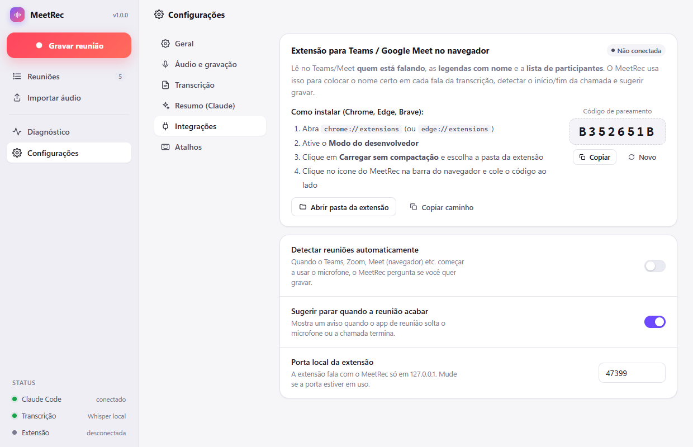

### Privacidade e segurança

- A extensão **só se comunica com o seu próprio computador** (`http://127.0.0.1`). Nada vai para a internet.
- Toda chamada exige o **código de pareamento**. O app recusa pedidos de páginas web e de origens que não sejam extensões.
- Ela não lê o conteúdo do chat, arquivos nem outras abas. Só a página da chamada no Teams/Meet.

> **Observação:** o Teams e o Meet mudam a estrutura das páginas com frequência. A extensão usa vários sinais alternativos, e o popup mostra em tempo real o que ela está detectando (quem fala, participantes, legendas lidas). Com as **legendas ao vivo ligadas**, a identificação fica bem mais precisa.

Sem a extensão (Teams desktop, Zoom etc.), o MeetRec separa **você** dos **participantes** pelas faixas de áudio, e você pode renomear os falantes na transcrição com um clique.

---

## 🧠 Motores de transcrição

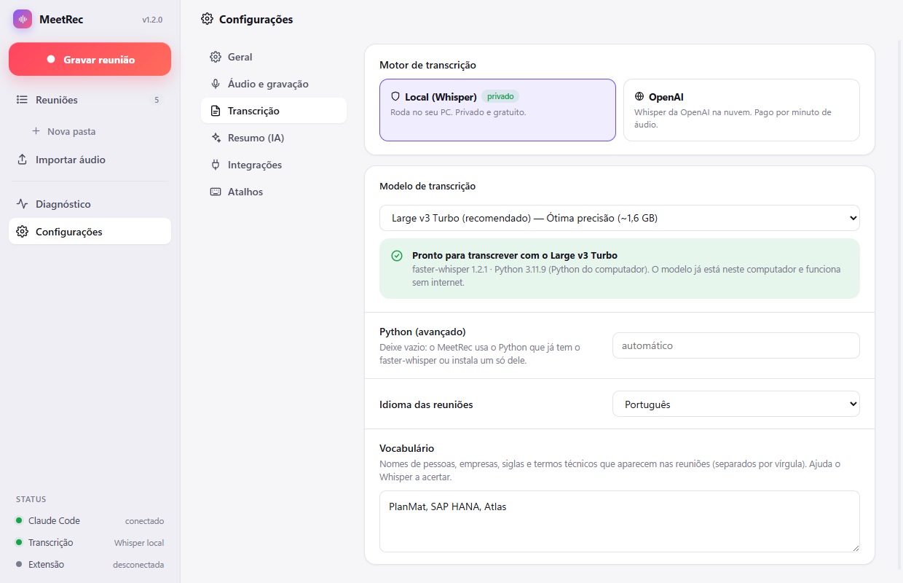

| Motor | Qualidade (PT-BR) | Velocidade | Privacidade | Custo |
|---|---|---|---|---|
| **Local** `small` | Razoável | Rápido | 🔒 100% local | Grátis |
| **Local** `medium` | Boa | Médio | 🔒 100% local | Grátis |
| **Local** `large-v3-turbo` | Muito boa | Lento em CPU | 🔒 100% local | Grátis |
| **Groq** (`whisper-large-v3-turbo`) | Muito boa | ⚡ segundos | Nuvem | Plano gratuito generoso |
| **OpenAI** (`whisper-1`) | Muito boa | Rápido | Nuvem | Pago por minuto |

**Dicas:**
- Sem GPU NVIDIA, o Whisper roda na CPU. Para usar o `large-v3-turbo` local sem pesar nas reuniões, desligue *Transcrever automaticamente* e use **Processar pendentes** quando o PC estiver livre.
- Preencha o **Vocabulário** com nomes de pessoas, siglas e sistemas da sua empresa. Isso melhora muito o reconhecimento.
- **Use fones de ouvido**: as faixas ficam mais limpas e a separação de falantes, perfeita.

---

## Formato do resumo

Se existir a skill `~/.claude/skills/resumo-reuniao/SKILL.md`, o MeetRec usa o formato dela. Caso contrário, usa o padrão embutido, em texto limpo para colar no Teams:

```
📋 PLANEJAMENTO DO Q4 — TIME DE PRODUTO
📅 12/10/2026 · 09:00 (BRT) · ~47 min
👥 Participantes: Ana Souza, Carlos Lima, Mariana Alves, Luis

━━━━━━━━━━━━━━━━━━━━
📝 RESUMO
━━━━━━━━━━━━━━━━━━━━

▸ Integração SAP HANA: importação manual até a liberação do acesso
• Bloqueio: a infraestrutura só libera o acesso na quarta-feira (Carlos).
• Solução de contorno: dados importados manualmente via planilha até lá.

━━━━━━━━━━━━━━━━━━━━
✅ ITENS DE AÇÃO
━━━━━━━━━━━━━━━━━━━━

☐ Carlos Lima: validar os dados importados até sexta-feira.
```

Em **Configurações → Resumo** você escolhe o modelo do Claude (Sonnet, Opus ou Haiku) e adiciona instruções próprias, como "destaque riscos" ou "escreva em inglês".

---

## 🔒 Seus dados

- Cada reunião fica numa pasta em `Documentos/MeetRec - Reuniões/<data>/`, com `meta.json`, os áudios (`mic.webm`, `system.webm`, `mix.webm`), `transcript.json`/`.txt` e `summary.md`. É só abrir, copiar ou fazer backup.
- O que sai do computador:
  - **a transcrição em texto** vai para o Claude, pelo seu Claude Code;
  - **o áudio** vai para a nuvem **só** se você escolher Groq ou OpenAI.
- As chaves de API ficam **criptografadas** pelo sistema operacional (`safeStorage`).

---

## ⌨️ Atalhos

| Atalho | Ação |
|---|---|
| `Ctrl/⌘ + Shift + R` | Iniciar / parar a gravação (funciona em qualquer app) |
| `Ctrl/⌘ + Shift + M` | Marcar momento importante |
| `Espaço` | Tocar / pausar o áudio da reunião aberta |

Os atalhos podem ser alterados em **Configurações → Atalhos**.

---

## 🛠 Desenvolvimento

```bash
git clone https://github.com/luiscriativo/meetrec.git
cd meetrec
npm install
npm start
```

| Comando | O que faz |
|---|---|
| `npm start` | Abre o app em modo de desenvolvimento |
| `npm run check` | Valida a sintaxe de todo o JS (CommonJS e módulos ES), JSON e Python |
| `npm run dist:win` / `dist:mac` / `dist:linux` | Gera o instalador localmente em `dist/` |
| `npm run icons` | Regera os ícones do app, da bandeja e da extensão |

**Dados de demonstração** (usados nos prints deste README):

```bash
python scripts/make-demo-data.py caminho/para/um-audio.webm
npx electron . --user-data=demo-data/profile
```

### Estrutura

```
src/
├─ main/                 processo principal (Node)
│  ├─ main.js            janelas, bandeja, atalhos, gravação, IPC
│  ├─ pipeline.js        fila: áudio → transcrição → falantes → resumo
│  ├─ transcribe.js      Whisper local (faster-whisper) e nuvem (Groq/OpenAI)
│  ├─ speakers.js        junta as faixas, remove eco, dá nome às falas
│  ├─ claude.js          integração com o Claude Code CLI (stream-json)
│  ├─ bridge.js          servidor local (127.0.0.1) da extensão
│  ├─ detector.js        detecta apps de reunião usando o microfone
│  ├─ diagnostics.js     verificações e instalação do motor local
│  ├─ updater.js         atualização automática pelas releases do GitHub
│  ├─ library.js         biblioteca de reuniões (pastas + meta.json)
│  └─ store.js           configurações (chaves criptografadas)
├─ preload/              ponte segura (contextIsolation)
└─ renderer/
   ├─ app/               interface principal (módulos ES, sem bundler)
   ├─ overlay/           indicador flutuante de gravação
   └─ recorder/          janela oculta que captura e mixa o áudio
python/transcribe.py     transcrição local com progresso em JSON
extension/               extensão Manifest V3 (Teams/Meet)
```

---

## 🚀 Publicando uma versão

As versões são geradas pelo GitHub Actions ([`.github/workflows/release.yml`](.github/workflows/release.yml)), sem nada para fazer no computador:

1. **Actions → Release → Run workflow**
2. Escolha o tipo de versão:

   | Tipo | Exemplo | Quando |
   |---|---|---|
   | `patch` | 1.0.0 → 1.0.1 | só correções |
   | `minor` | 1.0.0 → 1.1.0 | funcionalidades novas |
   | `major` | 1.0.0 → 2.0.0 | mudança grande |
   | `teste` | — | só gera os builds, sem versão nem release |

3. O workflow checa o código e gera os instaladores numa máquina por sistema/arquitetura. Só se **tudo** passar, ele grava a versão no `package.json` (commit `Versão X.Y.Z`), cria a tag e publica a release com a tabela de downloads, o `.zip` da extensão, os `latest*.yml` da atualização automática (juntados por `scripts/merge-update-info.cjs`) e o `SHA256SUMS.txt`. Assim que a release é publicada, os apps instalados recebem o aviso.
4. Desmarque **Publicar** para deixar a release como rascunho e revisar antes.

Também funciona com uma tag enviada à mão, com a versão já atualizada no `package.json`: `git tag v1.0.0 && git push origin v1.0.0` cria um rascunho.

Os arquivos seguem o padrão `MeetRec-<versão>-<sistema>-<arquitetura>`, por exemplo `MeetRec-1.2.0-win-x64-setup.exe`, `MeetRec-1.2.0-mac-arm64.dmg` e `MeetRec-1.2.0-linux-x86_64.AppImage`.

---

## ❓ Solução de problemas

| Problema | Solução |
|---|---|
| "Nenhum som do computador foi captado" | macOS: libere *Gravação de Tela e Áudio do Sistema*. Linux: escolha o dispositivo "Monitor of …". Windows: confira se o som da reunião sai neste PC. |
| "O Claude Code não está autenticado" | Abra um terminal, rode `claude` e faça login. |
| "Claude Code CLI não encontrado" | Instale com `npm i -g @anthropic-ai/claude-code` ou informe o caminho em *Configurações → Resumo*. |
| Transcrição local lenta | Use um modelo menor, o Groq, ou o modo "só gravar" + **Processar pendentes**. |
| Minha voz aparece duplicada | Use fones de ouvido. O MeetRec já remove o eco, mas caixas de som muito altas podem escapar. |
| Extensão "desconectada" | O app precisa estar aberto, e o código de pareamento tem que ser o mesmo (*Configurações → Integrações*). |

---

## Licença

[MIT](LICENSE) © luiscriativo
